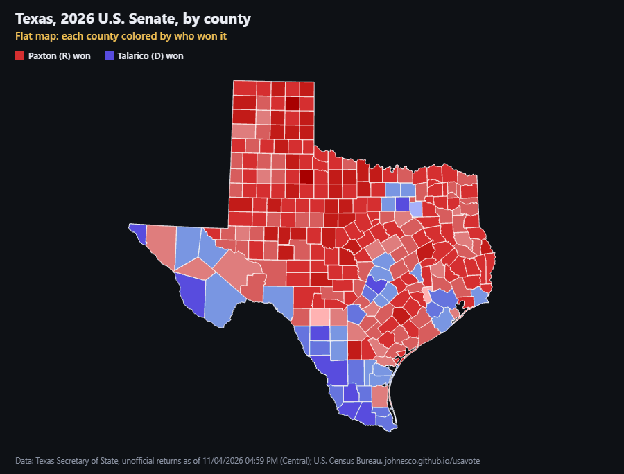

# How Texas Votes

An interactive map of all 18 statewide races in the Texas general election of Nov. 3, 2026, from U.S. Senate and
Governor to the state's high courts. It starts as the familiar flat county map, then raises each county into a column
whose height is the number of votes cast there. The point is to show why a map that is mostly red can still belong to
a statewide Democratic win. Each race has its own link, e.g. `?race=governor`.

**Live:** https://johnesco.github.io/texas/



## All races (computed from the data file)

| Race | Democrat | Republican | Statewide | Counties won (R / D) | Land in R-won counties |
|---|---|---|---|---|---|
| [U.S. Senate](https://johnesco.github.io/texas/?race=u-s-senate) | James Talarico | Ken Paxton | D 55.1% – R 43.0% | 214 / 40 | 78% |
| [Governor](https://johnesco.github.io/texas/?race=governor) | Gina Hinojosa | Greg Abbott (inc.) | D 52.8% – R 45.7% | 217 / 37 | 79% |
| [Lieutenant Governor](https://johnesco.github.io/texas/?race=lieutenant-governor) | Vikki Goodwin | Dan Patrick (inc.) | D 51.7% – R 45.6% | 218 / 36 | 80% |
| [Attorney General](https://johnesco.github.io/texas/?race=attorney-general) | Nathan Johnson | Mayes Middleton | D 52.4% – R 45.9% | 218 / 36 | 80% |
| [Comptroller of Public Accounts](https://johnesco.github.io/texas/?race=comptroller) | Sarah Eckhardt | Don Huffines | D 51.3% – R 46.2% | 220 / 34 | 80% |
| [Commissioner of the General Land Office](https://johnesco.github.io/texas/?race=land-commissioner) | Benjamin Flores | Dawn Buckingham (inc.) | D 51.4% – R 47.0% | 219 / 35 | 79% |
| [Commissioner of Agriculture](https://johnesco.github.io/texas/?race=agriculture-commissioner) | Clayton Tucker | Nate Sheets | D 51.3% – R 46.6% | 219 / 35 | 79% |
| [Railroad Commissioner](https://johnesco.github.io/texas/?race=railroad-commissioner) | Jon Rosenthal | Bo French | D 52.5% – R 45.5% | 218 / 36 | 80% |
| [Supreme Court, Chief Justice](https://johnesco.github.io/texas/?race=supreme-court-chief-justice) | Maggie Ellis | Jimmy Blacklock (inc.) | D 52.4% – R 47.6% | 219 / 35 | 80% |
| [Supreme Court, Place 2 (unexpired term)](https://johnesco.github.io/texas/?race=supreme-court-place-2) | Chari Kelly | James P. Sullivan (inc.) | D 52.3% – R 47.7% | 220 / 34 | 80% |
| [Supreme Court, Place 7](https://johnesco.github.io/texas/?race=supreme-court-place-7) | Kristen Hawkins | Kyle Hawkins (inc.) | D 52.8% – R 47.2% | 219 / 35 | 80% |
| [Supreme Court, Place 8](https://johnesco.github.io/texas/?race=supreme-court-place-8) | Gisela D. Triana | Brett Busby (inc.) | D 52.0% – R 48.0% | 220 / 34 | 80% |
| [Court of Criminal Appeals, Place 3](https://johnesco.github.io/texas/?race=criminal-appeals-place-3) | Okey Anyiam | Thomas Smith | D 50.0% – R 47.6% | 220 / 34 | 80% |
| [Court of Criminal Appeals, Place 4](https://johnesco.github.io/texas/?race=criminal-appeals-place-4) | Audra Riley | Kevin Patrick Yeary (inc.) | D 51.7% – R 48.3% | 220 / 34 | 80% |
| [Court of Criminal Appeals, Place 9](https://johnesco.github.io/texas/?race=criminal-appeals-place-9) | Holly Taylor | John Messinger | D 52.3% – R 47.7% | 220 / 34 | 80% |
| [15th Court of Appeals, Chief Justice](https://johnesco.github.io/texas/?race=fifteenth-court-chief-justice) | Jerry Zimmerer | Scott Brister (inc.) | D 51.8% – R 48.2% | 220 / 34 | 80% |
| [15th Court of Appeals, Place 2](https://johnesco.github.io/texas/?race=fifteenth-court-place-2) | Tom Baker | Scott K. Field (inc.) | D 52.0% – R 48.0% | 220 / 34 | 80% |
| [15th Court of Appeals, Place 3](https://johnesco.github.io/texas/?race=fifteenth-court-place-3) | Marc M. Meyer | April Farris (inc.) | D 51.5% – R 48.5% | 220 / 34 | 80% |

In every race the Democrat won statewide while the Republican won most counties and most of the land.

## U.S. House, Texas House and Texas Senate

Both pages also offer the **U.S. House**, the **Texas House** and the **Texas Senate**. Districts don't follow county lines, so each county's figure is
every district race held in it, added up by party; the sidebar compares the seats each party won with its share of the vote, and
notes districts with no candidate from one party. Counties where every race had a single candidate (no votes reported) are gray. Texas Senate terms are staggered, so only 15 or 16
of its 31 seats are up in most years (all 31 in 2012 and 2022, after redistricting); counties with no Senate race that year are gray too,
and the seat count is of the seats that were up.

| Year | U.S. House seats (D–R) | Texas House seats (D–R) | Texas Senate seats up (D–R) |
|---|---|---|---|
| 2008 | 12–20 | 74–76 | 7–8 of 15 |
| 2010 | 9–23 | 51–99 | 5–11 of 16 |
| 2012 | 12–24 | 55–95 | 12–19 of 31 |
| 2014 | 11–25 | 52–98 | 3–12 of 15 |
| 2016 | 11–25 | 55–95 | 8–8 of 16 |
| 2018 | 13–23 | 67–83 | 5–10 of 15 |
| 2020 | 13–23 | 67–83 | 8–8 of 16 |
| 2022 | 13–25 | 64–86 | 12–19 of 31 |
| 2024 | 13–25 | 62–88 | 7–8 of 15 |
| 2026 | 14–24 | 83–67 | 5–11 of 16 |

- **2026:** from the same election-night file as the statewide races; every candidate's total matches the Secretary of State's page.
- **2008–2024:** [`data/raw/sos-house-2008-2018.json`](data/raw/sos-house-2008-2018.json),
  [`data/raw/sos-house-2020-2024.json`](data/raw/sos-house-2020-2024.json),
  [`data/raw/sos-senate-2008-2018.json`](data/raw/sos-senate-2008-2018.json) and
  [`data/raw/sos-senate-2020-2024.json`](data/raw/sos-senate-2020-2024.json) were read in a web browser from the Secretary of State's
  Election History pages (one county-by-county page per district) and its results site (the county file), and checked there:
  every county adds up, the counties add up to each district, and each district matches the state's own summary. `build_history.py`
  checks them again, including that every year has every district (32, 36 or 38 U.S. House; 150 Texas House; for the
  Texas Senate, as many districts as were in that year's party primaries).
- Districts with a single candidate are left off the November ballot in Texas (3 Texas House districts in 2010; 4 U.S. House, 58
  Texas House and 10 Texas Senate in 2022). They count as a seat for the nominee's party, taken from the party primary results, and add no votes. In 2022 Texas Senate District 10 had nominees from both parties, but the Democrat, Beverly
  Powell, withdrew, so it is counted for the Republican, Phil King.
- In the 2022 results-site file, Ellis County's District 2 Senate total is twice its candidates' votes; the candidates' sum is used.
- Some accented letters on the 2008–2018 district pages were lost in extraction; `build_history.py` restores them (José, Peña, …).

## How we got there (history page)

[`history.html`](https://johnesco.github.io/texas/history.html) is a separate page, linked once from the main page. It maps
the major statewide races (President, U.S. Senate, Governor, Lieutenant Governor, Attorney General: whichever were on
the ballot) of every Texas general election from 2008 to 2026. That makes 23 races from 2008–2024, plus the four 2026
races. It reports each race the same way, without commentary: who won, the share and margin, the counties each candidate
carried, and votes cast. Each race has its own link, e.g. `history.html?race=2018-u-s-senate`.

## Flythrough (story page)

[`story.html`](https://johnesco.github.io/texas/story.html) is a scrolling infographic of the 2026 U.S. Senate race. The map
stays on screen while story cards scroll past; each card flies the camera to a group of counties (the reddest Panhandle
counties, Harris and the smallest counties, the five biggest counties, the flipped Dallas–Fort Worth suburbs, the Rio Grande
Valley), raises or flattens the columns, and lights up the counties it talks about. Raised columns are stacked by vote, as on
the main map. One step recolors every county by how far its margin moved from the 2024 presidential race to the 2026 Senate
race. Two cards go down the ballot: Democrats taking the Texas House (83–67), and the U.S. House, where Democrats won
most of the vote but 14 of 38 seats; those steps color each county by the chamber vote and show a strip of seats. Every number in the cards is computed in [`story.js`](story.js) from the two data files; only the choice of counties to
visit is written by hand. Plain HTML, CSS and JS, with the same three.js / d3-geo / topojson-client modules as the map. The
county drawing code it uses is in [`map3d.js`](map3d.js).

## See every single voter (dot page)

[`voters.html`](https://johnesco.github.io/texas/voters.html) is an animation that plays on its own, with one dot for each of the
9,889,704 people who voted in the 2026 U.S. Senate race, always over the flat map. After the whole state, it visits one
place at a time, and each visit runs from far to near: the metro from high up, then one county, then down to its most
crowded spot. Houston (Harris), the border (Hidalgo), Austin and San Antonio, ending in the most crowded neighborhood in the
state; then, at that same zoom, the emptiest county (Loving), from very dense to nearly empty. Then El Paso, Lubbock and
Dallas–Fort Worth (the most crowded county), in an order that keeps the flights short. Each close-up zooms in as far as that spot needs: the typical gap between voters there is drawn about 16 pixels
wide. `?scene=N` opens it at scene N.

The results give votes by county, not by address. Precinct results for 2026 aren't published yet, so the dots are placed by
the pattern of the 2024 U.S. Senate race (Allred vs. Cruz) inside each county. Each party's 2026 county total is shared among the
county's 2024 voting districts (VTDs) in proportion to that party's 2024 votes there, so every county still adds up exactly to
its 2026 result and each neighborhood keeps its own party mix. Within each VTD, the dots are shared among its census blocks by
population 18 and over (2020 Census), and scattered around each block with a soft bell-curve spread about the block's size, so
neighboring blocks blend together. A dot that lands where the 2020 Census counted no one (a lake, a bay, an airport, a big park)
gets a new spot around the same block; that moves about 2% of the dots. [`dots-worker.js`](dots-worker.js) places the dots in a background thread;
[`dots.js`](dots.js) draws them.

The map pages take the same dots with `?voters=1`: the 3D view's columns are built from one dot per voter (one per 10 on
phones), placed the same way and scaled to whichever race is shown. If the precinct file fails to load, the dots are spread
evenly over each county.

### Precinct data

[`scripts/build_precincts.py`](scripts/build_precincts.py) builds [`data/precincts.json.gz`](data/precincts.json.gz) (gzipped
to keep the site small; [`dots.js`](dots.js) unzips it in the browser) from the Texas Legislative Council's
[Capitol Data Portal](https://data.capitol.texas.gov) (2024 general election, U.S. Senator by VTD, and the `VTDs_24PG`
boundaries, converted from their Lambert conformal conic projection) and the 2020 Census block points, land areas and adults
(P.L. 94-171, `P3_001N`). Each block is assigned to the VTD that contains its internal point. It also finds each county's most
crowded spot (adults within half a mile) for the close-ups. The Census files come from
[`scripts/build_blockgroups.py`](scripts/build_blockgroups.py), which downloads them into `data/raw/census-dl/` and checks that
the adults add up to the state total (21,866,700); run it first. (It also writes `data/blockgroups.json`, adults by block group,
which the site no longer uses and isn't committed.)

[`scripts/build_landmask.py`](scripts/build_landmask.py) builds [`data/landmask.bin.gz`](data/landmask.bin.gz) (about 1 MB): a
100 m grid over Texas, in the map's projection, of the cells touching any census block with people or housing units (2020
TIGER/Line tabulation blocks, `POP20` and `HOUSING20`; a 750 MB download into `data/raw/census-dl/tiger/`). Every other cell is
empty. It marks land nobody was counted on, not homes: inside a block that has people, a dot can land anywhere.

```bash
python scripts/build_blockgroups.py
```

```bash
python scripts/build_precincts.py
python scripts/build_landmask.py
```

## City names

Every map names cities and towns for reference ([`cities.js`](cities.js)). Which names show depends on the zoom: with the
whole state on screen, cities of about 100,000 people or more; zoomed in, smaller towns too, down to 500 people. Larger
places win where names would overlap, and names keep clear of county labels and on-screen controls. On the 3D pages the names
fade out while the columns are raised, since a name on the ground would float over the wrong column.
[`scripts/build_cities.py`](scripts/build_cities.py) builds [`data/cities.json`](data/cities.json) (994 places) from the
2020 Census redistricting file's place records: every incorporated city, town and village with at least 500 people, and
census-designated places (unincorporated communities such as The Woodlands) with at least 10,000, each at its Census
internal point.

```bash
python scripts/build_cities.py
```

## Infographic

[`scripts/build_infographic.py`](scripts/build_infographic.py) draws the county map beside the one-dot-per-voter map, with
legends and sources, at 4K (or `2` for 8K, `4` for 16K). The PNGs aren't committed.

```bash
python scripts/build_infographic.py 4
```

## Share image

[`scripts/panels.html`](scripts/panels.html) draws the two-panel image "Texas Looks Red / But Talarico Won" with stacked
columns, every figure computed from the data (`?race=<id>` for another race). With the local server running:

```bash
chrome --headless=new --hide-scrollbars --force-device-scale-factor=2 --window-size=1802,684 --virtual-time-budget=20000 --screenshot=texas-looks-red-panels-split.png http://localhost:8765/scripts/panels.html
```

## Data and method

- **Results:** Texas Secretary of State, Election Night Returns, 2026 November General Election (election id 53815),
  county-level results for every statewide race, as of 11/04/2026 04:59 PM Central, retrieved 2026-11-04. All precincts are
  reporting in all 254 counties. These results are **unofficial** until the state canvass.
  - Results site: https://goelect.txelections.civixapps.com/ivis-enr-ui/races
  - Data feed: https://goelect.txelections.civixapps.com/api-ivis-system/api/s3/enr/election/countyInfo/53815
  - Statewide page used as a cross-check: https://electionresults.sos.state.tx.us/results.html
- **Land area and FIPS codes:** U.S. Census Bureau, 2024 Gazetteer Files, counties (`ALAND_SQMI`, water excluded).
  https://www.census.gov/geographies/reference-files/time-series/geo/gazetteer-files.html
- **County shapes:** U.S. Census Bureau cartographic boundary files, 2017, via
  [us-atlas](https://github.com/topojson/us-atlas) v3.0.1 (`counties-10m.json`).
- **Column height** is proportional to the total votes cast in the selected race, counting every candidate including
  write-ins, on a linear scale (one scale shared by all races). Counties with very few votes get a thin minimum height so they stay visible.
- **Color** is the county winner's share of all votes cast there, in 10-point bands.

The raw snapshots are kept locally in `data/raw/`, not in this repo, except for the hand-read extracts linked on this page. They
are in the repo's history up to this change, and the sources are listed below. [`scripts/build_data.py`](scripts/build_data.py) rebuilds
[`data/results-2026.json`](data/results-2026.json) from them. That file holds all 18 races that were on the ballot in
all 254 counties, and the page offers every one of them. The script stops with an
error unless all of these hold, for every race:

- the race is reported in each of the 254 counties, with all precincts reporting
- each county's candidate votes add up to its race total
- every county matches a Census FIPS code
- every candidate's county votes add up exactly to that candidate's total on the Secretary of State's statewide page

Candidate names are listed in capitals by the Secretary of State; the script converts them to normal capitalization
for display (e.g. McCormick, and DiBianca as spelled by [Ballotpedia](https://ballotpedia.org/Arthur_DiBianca)).

```bash
python scripts/build_data.py
```

### Earlier elections

[`scripts/build_history.py`](scripts/build_history.py) builds [`data/results-history.json`](data/results-history.json):

- **2008–2018:** Texas Secretary of State, [Election History](https://elections.sos.state.tx.us/index.htm) (official
  canvassed results), one page per race, saved as `data/raw/sos-<year>-<race>.htm`. The script checks that each county's
  candidate votes add up to its total, and that the counties add up to the page's statewide row.
- **2020–2024:** Texas Secretary of State, [election results site](https://results.texas-election.com/races), final
  county results (`static/data/election/<id>/<version>/County.json`; 2020 = 44144, 2022 = 47009, 2024 = 49664). The site
  blocks scripted downloads, so the files were opened in a browser and the major races were extracted to
  `data/raw/sos-enr-<year>-extract.json` (Democratic, Republican and total votes per county, plus each candidate's statewide total).
  During extraction, every county was checked to add up and every candidate's county votes were checked against the site's
  statewide file. The build script checks the extracts again.

```bash
python scripts/build_history.py
```

Both pages share [`style.css`](style.css) and [`app.js`](app.js); `<body data-page="now|history">` selects the page.

## Running locally

The page loads its data with `fetch`, so it has to be served over HTTP:

```bash
python -m http.server 8765
```

Then open http://localhost:8765.

Built with [three.js](https://threejs.org) r160, [d3-geo](https://github.com/d3/d3-geo) 3.1.1 and
[topojson-client](https://github.com/topojson/topojson-client) 3.1.0.
